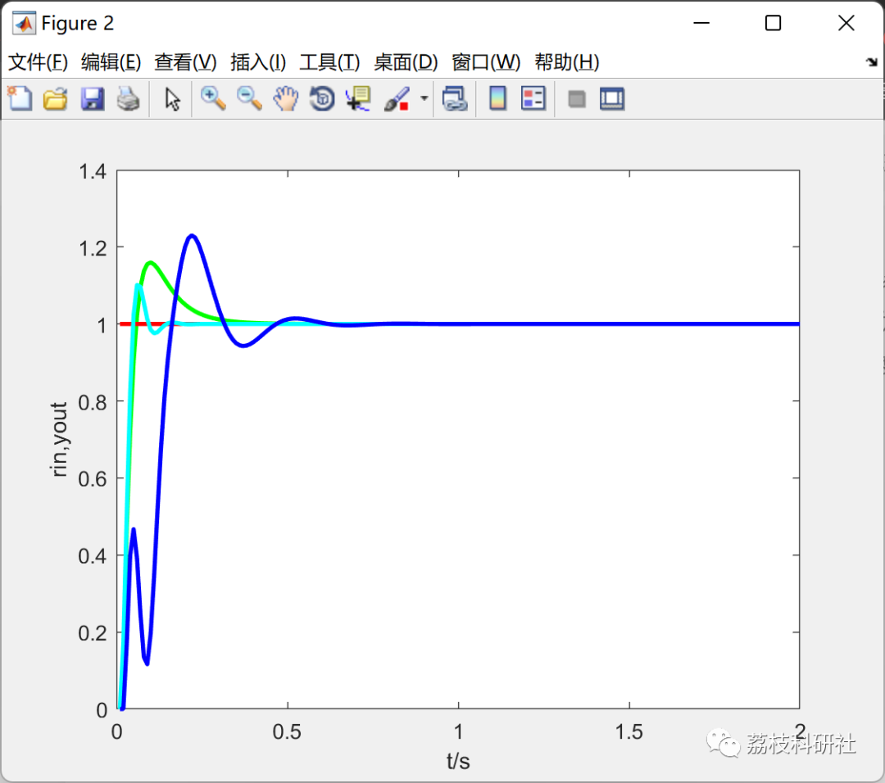
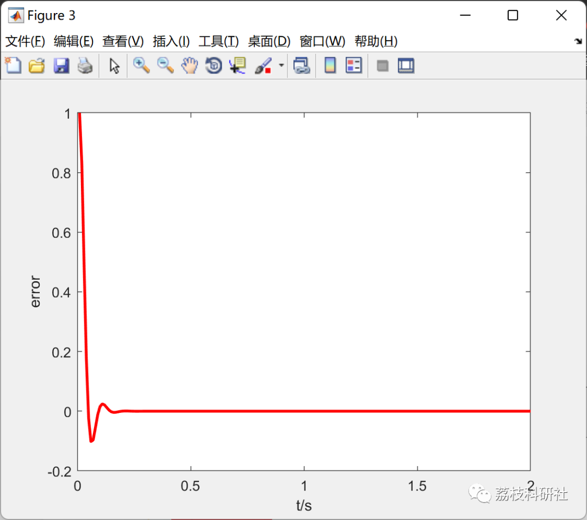
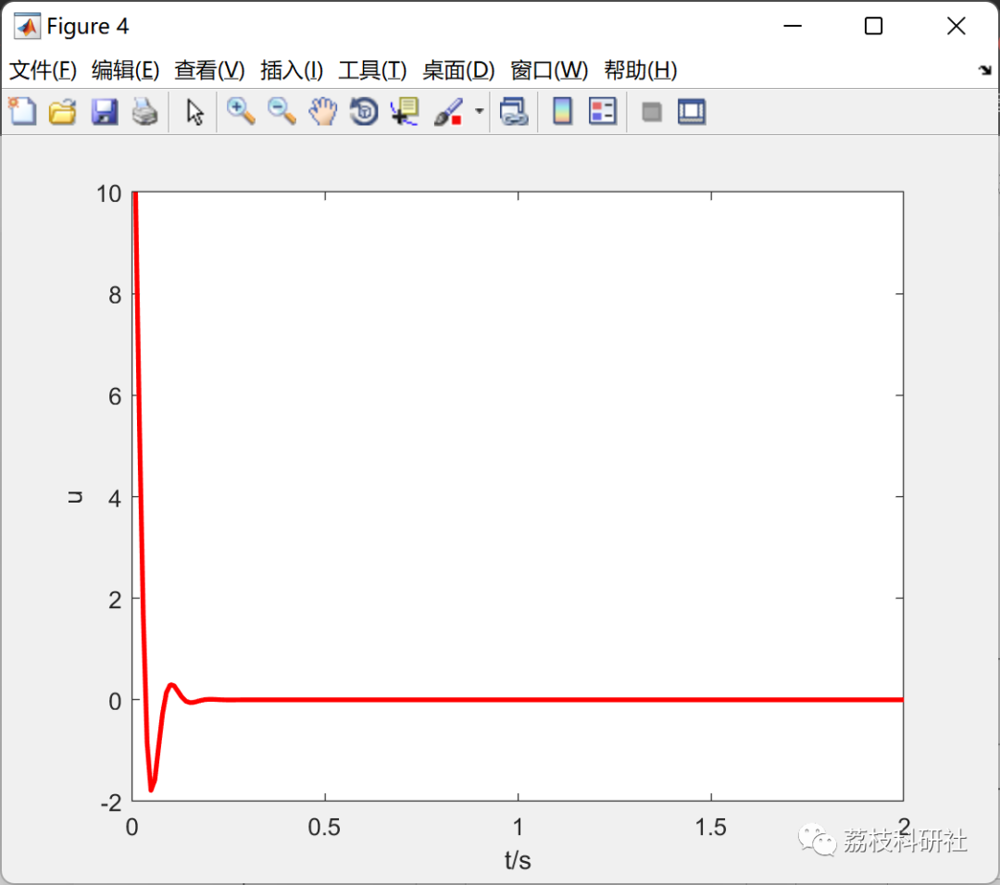
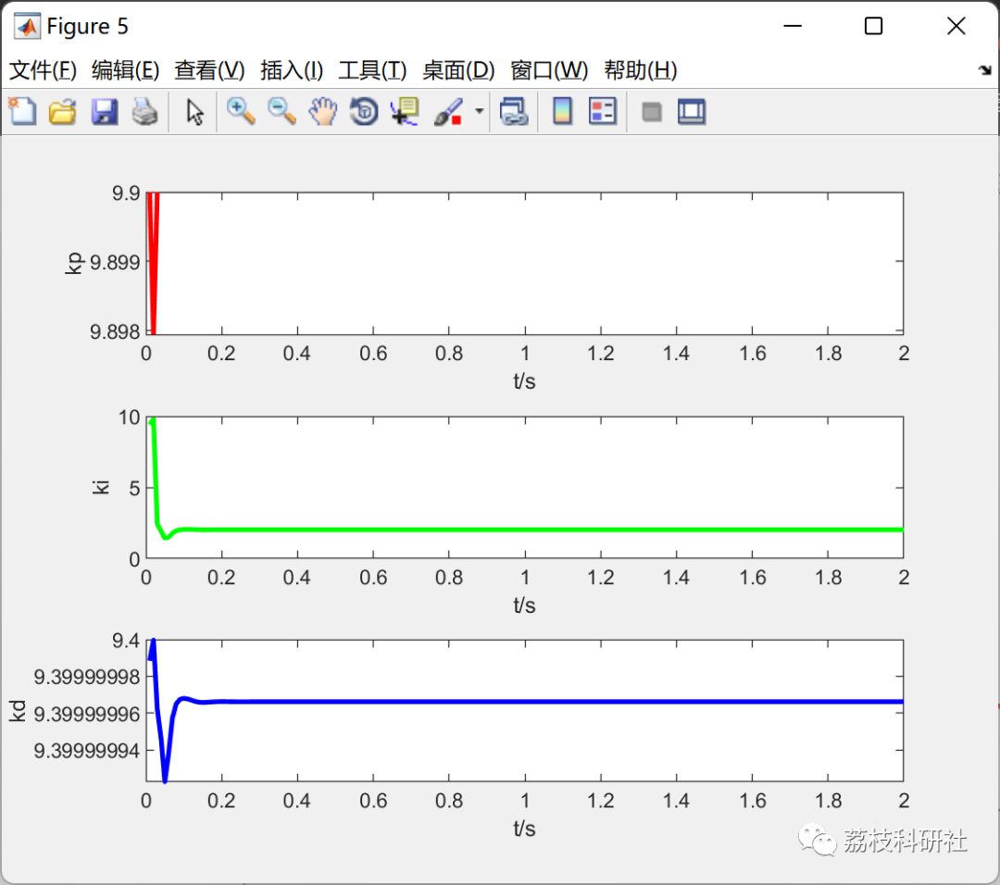

# PID Control Algorithm Optimized by Particle Swarm Algorithm Based on BP Neural Network (Matlab Code)

​  
💥💥💥💞💞💞💞 Welcome to this blog❤️❤️❤️💥💥💥
🏆 Bloggers' Advantage: 🌞🌞🌞 The content of the blog strives to be rigorous in thought and clear in logic, for the convenience of readers.
⛳️ Mantra: The journey of a hundred miles is half done in the last ninety.
Litchi Research Society
Code Collection: Power System, Intelligent Algorithms and Applications, Neural Network Prediction, Path Planning, Optimized Scheduling, Workshop Scheduling, Image Processing, Signal Processing...
🎁Column Directory Link:
🌈🌈🌈🌟🌟🌟Electrical Code Intelligent Algorithm and Its Application Path Planning Neural Network Predictive Optimization Scheduling Image Processing Workshop Scheduling Signal Processing Romantic Her My Philosophical Thoughts Math Modeling Complete Code Matters
Contents
💥1 Overview
📚2 Running Results
🎉3 References
🌈4 Matlab code implementation
💥1 Overview
The traditional Proportional-Integral-Derivative (PID) controller has difficulties in parameter tuning, cannot adjust online in real time, and performs poorly when applied to complex nonlinear systems. This paper proposes a Back Propagation (BP) neural network PID control method optimized by the Particle Swarm Optimization (PSO). By combining the BP neural network with the PID controller, the adaptive learning capability of the BP neural network is utilized to adjust the PID control parameters online and in real time, enhancing system stability. To address the issue of the BP-PID system easily falling into local minima during its self-learning process, an improved PSO algorithm is employed for optimization, ensuring that the BP-PID system converges to the global optimal solution. Experiments based on simulation data show that the proposed method can effectively improve the control precision and stability of the system.
📚2 Running Results
🎉3 References
[1] Zeng Xiongfei. Optimizing PID Control Algorithm Based on Particle Swarm Optimization for BP Neural Networks [J]. Electronic Design Engineering, 2022, 30(11): 69-73+78. DOI: 10.14022/j.issn1674-6236. 2022.11.015.
🌈 4 MATLAB Code Implementation
Click the left bottom corner of the article to read more.

## Images

<!-- PAYMENT_BLOCK -->

## Get this dataset

- Payment link (Stripe): [Buy now](https://buy.stripe.com/3cs8yP7sY87d0vu9AB)
- Payment QR code: 

<!-- /PAYMENT_BLOCK -->
